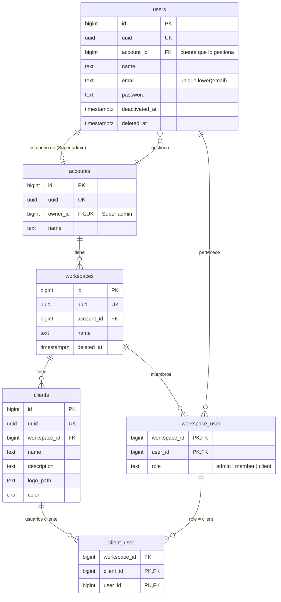
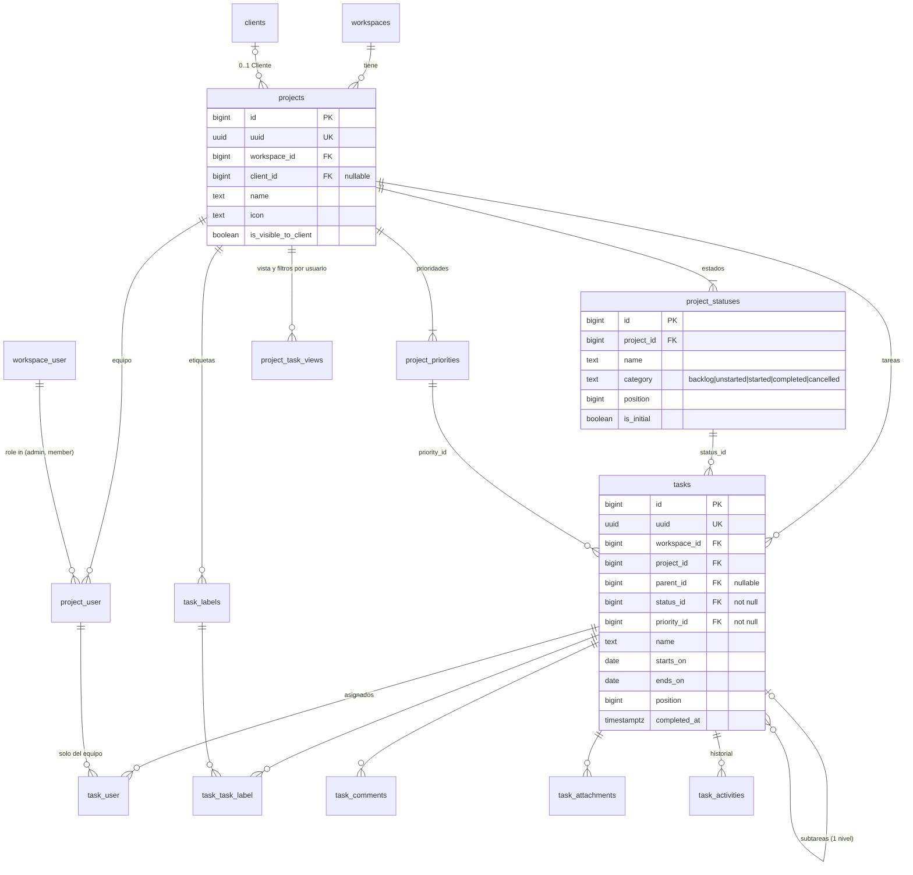
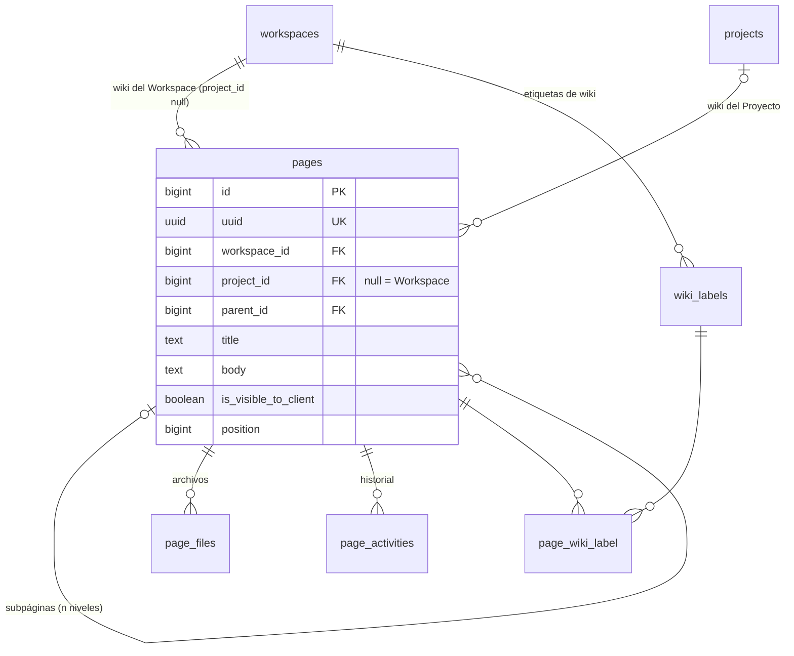

# Modelo de datos — Workbench

> Diseño completo de la base de datos a partir de `docs/flujo-canonico.md` (E1–E10, RN-01–RN-27).
> Motor: **PostgreSQL 18** (instalado: 18.6). Tablas, columnas y valores en inglés; prosa en español (RN-20).
> Fecha: 2026-11-21. Actualizado: 2026-11-24 (E11 · Pizarra). Estado: **implementado** en las migraciones de dominio (sección 11 lista archivos, modelos y tests).

## Índice

1. [Principios de diseño](#1-principios-de-diseño)
2. [Convenciones](#2-convenciones)
3. [Mapa de dominios](#3-mapa-de-dominios)
4. [Diagramas entidad-relación](#4-diagramas-entidad-relación)
5. [Diccionario de datos](#5-diccionario-de-datos)
6. [Integridad: reglas de negocio en la base](#6-integridad-reglas-de-negocio-en-la-base)
7. [Papelera (RN-19)](#7-papelera-rn-19)
8. [Historial de cambios (RN-08, RN-09)](#8-historial-de-cambios-rn-08-rn-09)
9. [Índices y consultas críticas](#9-índices-y-consultas-críticas)
10. [Escalabilidad](#10-escalabilidad)
11. [Implementación](#11-implementación)
12. [Decisiones](#12-decisiones)
13. [Extensiones previstas (fuera del MVP)](#13-extensiones-previstas-fuera-del-mvp)

---

## 1. Principios de diseño

| # | Principio | Qué significa en este modelo |
|---|---|---|
| P1 | **El Workspace es la frontera de tenant** | Toda fila de contenido lleva `workspace_id`. Ninguna consulta de la aplicación cruza Workspaces. Es la clave de RLS, de particionado y de distribución futura (sección 10). |
| P2 | **La base garantiza lo que puede garantizar** | Jerarquía, pertenencia y consistencia entre tenants se aseguran con FK compuestas, `CHECK`, índices únicos parciales y unos pocos triggers. La aplicación no es la única barrera. |
| P3 | **Identificador interno ≠ identificador público** | PK `bigint` identity para joins y FK compactas; columna `uuid` (UUIDv7, ordenable por tiempo) para URLs, API y nombres de archivo. No se exponen ids secuenciales. |
| P4 | **Borrado lógico uniforme** | Todo lo borrable tiene `deleted_at` + `deleted_by_id`. Las unicidades son parciales (`where deleted_at is null`). |
| P5 | **Historial append-only** | Las tablas de actividad solo admiten `insert`. Se diseñan para particionarse por tiempo cuando el volumen lo pida. |
| P6 | **Configuración como datos, semántica como enum** | Estados y prioridades son filas por Proyecto (configurables), pero cada estado declara una `category` fija para que la aplicación razone sin depender de nombres. |
| P7 | **Enums en `text` + `CHECK`** | No se usan tipos `enum` de PostgreSQL (difíciles de alterar). En PHP, enums respaldados por string con cast. |
| P8 | **Tiempo con zona** | `timestamptz` en todas las marcas de tiempo; `date` solo para fechas de calendario (inicio y término de Tareas). |

## 2. Convenciones

**Nombres**
- Tablas en plural `snake_case` (`tasks`, `project_statuses`); pivotes en singular y orden alfabético, convención de Laravel (`project_user`, `task_task_label`).
- FK `<entidad>_id`; autoría `created_by_id`, `updated_by_id`, `deleted_by_id` → `users.id`.
- Booleanos con prefijo `is_` / `has_`; fechas de calendario `*_on`; marcas de tiempo `*_at`.
- Índices: `<tabla>_<columnas>_<tipo>` (`tasks_project_id_status_id_position_index`); constraints `CHECK`: `<tabla>_<regla>` (`tasks_ends_on_after_starts_on`).

**Columnas estándar**

| Columna | Tipo | Dónde | Nota |
|---|---|---|---|
| `id` | `bigint generated by default as identity` | todas las entidades | `$table->id()` |
| `uuid` | `uuid not null default uuidv7()` + `unique` | entidades expuestas en URL | `uuidv7()` es nativo en PG 18. En Laravel: `HasUuids` + `uniqueIds(): ['uuid']` + `getRouteKeyName(): 'uuid'` |
| `created_at`, `updated_at` | `timestamptz` | entidades | `$table->timestampsTz()` |
| `deleted_at` | `timestamptz null` | entidades borrables | `$table->softDeletesTz()` |
| `deleted_by_id` | `bigint null → users` | entidades borrables | quién envió a la papelera |
| `position` | `bigint not null` | listas ordenables | huecos de 1024; se rebalancea si dos vecinos quedan contiguos |
| `color` | `char(7)` + `CHECK (color ~ '^#[0-9a-fA-F]{6}$')` | clientes, estados, etiquetas | |

**Políticas de borrado de FK**
- Hacia el padre de negocio (Workspace, Proyecto, Tarea, Página): `restrict`. Nada se borra físicamente en cascada; el flujo normal es el borrado lógico.
- Pivotes: `cascade` (no tienen identidad propia).
- Autoría (`*_by_id`, `user_id` de comentarios y archivos): `restrict` — los usuarios también se borran solo de forma lógica (RN-14).

## 3. Mapa de dominios

| Dominio | Tablas | Etapas |
|---|---|---|
| **Identidad y tenancy** | `users`, `accounts`, `workspaces`, `workspace_user` | E1, E3 |
| **Autorización** (spatie) | `roles`, `permissions`, `model_has_roles`, `model_has_permissions`, `role_has_permissions` | E3 |
| **Clientes** | `clients`, `client_user` | E2, E3, E10 |
| **Proyectos** | `projects`, `project_user`, `project_statuses`, `project_priorities`, `task_labels` | E4, E11 |
| **Tareas** | `tasks`, `task_user`, `task_task_label`, `task_comments`, `task_comment_mentions`, `task_followers`, `task_attachments`, `task_activities` | E5, E6 |
| **Vistas** | `project_task_views` | E7 |
| **Pizarra** | `board_entries`, `board_project_hides` (y columnas de `projects`) | E11 |
| **Wiki** | `pages`, `page_comments`, `page_comment_mentions`, `page_followers`, `page_files`, `page_activities`, `wiki_labels`, `page_wiki_label` | E8 |
| **Papelera** | vista `trash_items` | E9 |
| **Framework** | `sessions`, `password_reset_tokens`, `cache`, `cache_locks`, `jobs`, `job_batches`, `failed_jobs` | — |

Jerarquía de pertenencia (RN-02):

```
Account ─< Workspace ─┬─< Client ─< (0..n) Project
                      ├─< Project ─┬─< ProjectStatus / ProjectPriority / TaskLabel
                      │            ├─< Task ─< Task (subtarea, 1 nivel)
                      │            └─< Page (wiki del Proyecto)
                      ├─< Page (wiki del Workspace, project_id null)
                      └─< WikiLabel
```

## 4. Diagramas entidad-relación

### 4.1 Identidad, tenancy y clientes



### 4.2 Proyectos y Tareas



### 4.3 Wiki



## 5. Diccionario de datos

> Se omiten en cada tabla las columnas estándar de la sección 2 cuando se indican con ✓ en la fila «Estándar».

### 5.1 `users`
Persona que inicia sesión. Global (un correo = un usuario), puede estar en Workspaces de varias Cuentas (RN-03).

| Columna | Tipo | Null | Nota |
|---|---|---|---|
| `id`, `uuid` | | no | |
| `account_id` | `bigint → accounts` | sí | Cuenta que creó y gestiona al usuario (quién puede desactivarlo o eliminarlo). Para un Super admin, su propia Cuenta |
| `name` | `varchar(255)` | no | |
| `email` | `varchar(255)` | no | único con `unique index on lower(email)` |
| `email_verified_at` | `timestamptz` | sí | |
| `password` | `varchar(255)` | no | hash |
| `remember_token` | `varchar(100)` | sí | |
| `deactivated_at` | `timestamptz` | sí | bloqueo lógico (A-09). No nulo ⇒ no entra |
| `deactivated_by_id` | `bigint → users` | sí | |
| Estándar | ✓ timestamps, `deleted_at`, `deleted_by_id` | | borrado lógico (A-10) |

### 5.2 `accounts`
La **Cuenta** del glosario: ámbito de un Super admin. Se crea por consola junto con su dueño (RN-01).

| Columna | Tipo | Null | Nota |
|---|---|---|---|
| `id`, `uuid` | | no | |
| `owner_id` | `bigint → users` | no | **unique**. Un usuario es Super admin ⇔ es dueño de una Cuenta |
| `name` | `varchar(255)` | no | por defecto, el nombre del dueño |
| Estándar | ✓ timestamps | | sin borrado lógico (se administra por consola) |

### 5.3 `workspaces`
| Columna | Tipo | Null | Nota |
|---|---|---|---|
| `id`, `uuid` | | no | |
| `account_id` | `bigint → accounts` restrict | no | Cuenta dueña; su `owner_id` es el Super admin del Workspace |
| `name` | `varchar(255)` | no | |
| `created_by_id` | `bigint → users` | no | |
| Estándar | ✓ timestamps, borrado lógico | | |

Visibilidad (RN-03, P-17): un usuario ve los Workspaces de las Cuentas que posee **o** aquellos donde tiene fila en `workspace_user`.

### 5.4 `workspace_user` (modelo `WorkspaceMember`)
Membresía e **única fuente de verdad del rol** dentro del Workspace (RN-15). El Super admin no tiene fila: su acceso viene de la Cuenta.

| Columna | Tipo | Null | Nota |
|---|---|---|---|
| `workspace_id` | `bigint → workspaces` cascade | no | PK compuesta |
| `user_id` | `bigint → users` cascade | no | PK compuesta |
| `role` | `varchar(16)` | no | `CHECK (role in ('admin','member','client'))` |
| `created_by_id` | `bigint → users` | sí | quién lo creó/invitó (Super admin o admin, RN-26) |
| `created_at`, `updated_at` | `timestamptz` | | |

Índices: PK `(workspace_id, user_id)`, `(user_id)`, `(workspace_id, role)`.

### 5.5 `clients`
| Columna | Tipo | Null | Nota |
|---|---|---|---|
| `id`, `uuid` | | no | |
| `workspace_id` | `bigint → workspaces` restrict | no | |
| `name` | `varchar(255)` | no | único activo por Workspace (`lower(name)`) |
| `description` | `text` | sí | |
| `logo_path` | `varchar(512)` | sí | clave en el disco de archivos |
| `color` | `char(7)` | sí | `CHECK` hex |
| `created_by_id` | `bigint → users` | no | |
| Estándar | ✓ timestamps, borrado lógico | | |

`unique (id, workspace_id)`: destino de FK compuestas (garantiza que un Proyecto o un usuario cliente se relacione con un Cliente **del mismo Workspace**).

### 5.6 `client_user`
Usuarios cliente de cada Cliente; un usuario cliente puede estar en varios (RN-04, P-03).

| Columna | Tipo | Null | Nota |
|---|---|---|---|
| `workspace_id` | `bigint` | no | denormalizado para las FK compuestas |
| `client_id` | `bigint` | no | PK; FK `(client_id, workspace_id) → clients(id, workspace_id)` cascade |
| `user_id` | `bigint` | no | PK; FK `(workspace_id, user_id) → workspace_user` cascade |
| `created_at` | `timestamptz` | | |

Trigger `client_user_requires_client_role`: la membresía referenciada debe tener `role = 'client'`.

### 5.7 `projects`
| Columna | Tipo | Null | Nota |
|---|---|---|---|
| `id`, `uuid` | | no | |
| `workspace_id` | `bigint → workspaces` restrict | no | |
| `client_id` | `bigint` | sí | FK `(client_id, workspace_id) → clients(id, workspace_id)`; null = sin Cliente (A-04) |
| `name` | `varchar(255)` | no | |
| `description` | `text` | sí | |
| `icon` | `varchar(32)` | sí | emoji o nombre de icono |
| `is_visible_to_client` | `boolean` | no | default `false`. Se registra sin efecto (RN-05) |
| `priority` | `varchar(16)` | no | default `none`. `CHECK (priority in ('none','low','medium','high','urgent'))`. Prioridad del Proyecto, comparable entre Proyectos; no es `project_priorities` (RN-11) |
| `due_on` | `date` | sí | fecha de término del Proyecto. Vencido si es anterior a hoy y `paused_at` es null |
| `paused_at` | `timestamptz` | sí | pausa reversible. No es archivado ni papelera (RN-11) |
| `paused_by_id` | `bigint → users` restrict | sí | quién pausó |
| `board_position` | `bigint` | no | orden compartido de la fila en la Pizarra. Huecos de 1024 (D-09) |
| `created_by_id` | `bigint → users` | no | siempre un Super admin (RN-13) |
| Estándar | ✓ timestamps, borrado lógico | | |

Índice parcial `projects_workspace_board_position_index` en `(workspace_id, board_position) where deleted_at is null`.

`unique (id, workspace_id)` para FK compuestas.

### 5.8 `project_user` (Equipo del Proyecto)
| Columna | Tipo | Null | Nota |
|---|---|---|---|
| `workspace_id` | `bigint` | no | FK `(project_id, workspace_id) → projects(id, workspace_id)` cascade |
| `project_id` | `bigint` | no | PK |
| `user_id` | `bigint` | no | PK; FK `(workspace_id, user_id) → workspace_user` cascade |
| `created_by_id` | `bigint → users` | sí | |
| `created_at` | `timestamptz` | | |

Trigger `project_user_requires_internal_role`: la membresía debe ser `admin` o `member` (nunca `client`). Como `task_user` referencia a `project_user`, esto garantiza RN-18 en cascada (sección 6).

### 5.9 `project_statuses`
| Columna | Tipo | Null | Nota |
|---|---|---|---|
| `id` | | no | |
| `project_id` | `bigint → projects` restrict | no | |
| `name` | `varchar(64)` | no | único activo por Proyecto (`lower(name)`) |
| `category` | `varchar(16)` | no | `CHECK (category in ('backlog','unstarted','started','completed','cancelled'))` |
| `color` | `char(7)` | sí | |
| `position` | `bigint` | no | orden de columnas del kanban |
| `is_initial` | `boolean` | no | default `false`; a lo más uno activo por Proyecto (índice único parcial) |
| Estándar | ✓ timestamps, borrado lógico | | |

`unique (id, project_id)` para FK compuestas desde `tasks`.

Valores por defecto (se crean al crear el Proyecto, RN-06, P-32):

| position | name | category | is_initial |
|---|---|---|---|
| 1024 | Backlog | backlog | ✓ |
| 2048 | Por hacer | unstarted | |
| 3072 | En curso | started | |
| 4096 | Hecho | completed | |
| 5120 | Cancelado | cancelled | |

`category` no es visible para el usuario en el MVP: permite saber qué Tareas están cerradas (`completed`/`cancelled`) aunque el Proyecto renombre «Hecho» a «Listo», y alimenta `tasks.completed_at`, reportes y vistas entre Proyectos.

### 5.10 `project_priorities`
| Columna | Tipo | Null | Nota |
|---|---|---|---|
| `id` | | no | |
| `project_id` | `bigint → projects` restrict | no | |
| `name` | `varchar(64)` | no | único activo por Proyecto |
| `color` | `char(7)` | sí | |
| `position` | `bigint` | no | menor = menos urgente; ordena por urgencia |
| `is_initial` | `boolean` | no | a lo más uno activo por Proyecto |
| Estándar | ✓ timestamps, borrado lógico | | |

Por defecto (RN-16): ninguna (inicial), baja, media, alta, urgente. `unique (id, project_id)`.

### 5.11 `task_labels`
| Columna | Tipo | Null | Nota |
|---|---|---|---|
| `id` | | no | |
| `project_id` | `bigint → projects` restrict | no | |
| `name` | `varchar(64)` | no | único activo por Proyecto |
| `color` | `char(7)` | sí | |
| Estándar | ✓ timestamps, borrado lógico | | sin valores por defecto (RN-06) |

`unique (id, project_id)`.

### 5.12 `tasks`
Tarea y subtarea comparten tabla y datos (RN-17).

| Columna | Tipo | Null | Nota |
|---|---|---|---|
| `id`, `uuid` | | no | |
| `workspace_id` | `bigint` | no | FK `(project_id, workspace_id) → projects(id, workspace_id)` |
| `project_id` | `bigint` | no | |
| `parent_id` | `bigint` | sí | FK `(parent_id, project_id) → tasks(id, project_id)`: la subtarea es del mismo Proyecto |
| `status_id` | `bigint` | **no** | FK `(status_id, project_id) → project_statuses(id, project_id)` (RN-07, A-22) |
| `priority_id` | `bigint` | no | FK `(priority_id, project_id) → project_priorities(id, project_id)` |
| `name` | `varchar(255)` | no | |
| `description` | `text` | sí | contenido del editor (HTML saneado) |
| `starts_on`, `ends_on` | `date` | sí | `CHECK (ends_on >= starts_on)` (A-06) |
| `position` | `bigint` | no | orden dentro de su columna del kanban / de su Tarea padre |
| `completed_at` | `timestamptz` | sí | lo fija el trigger `tasks_apply_workflow` al pasar a un estado `completed`/`cancelled` (se conserva entre estados cerrados); se limpia al salir |
| `created_by_id` | `bigint → users` | no | |
| `search_vector` | `tsvector` generado `stored` | no | `name` (peso A) + `description` (peso B), configuración `spanish` sin tildes |
| Estándar | ✓ timestamps, borrado lógico | | |

`unique (id, project_id)` para las FK compuestas de subtareas, asignados y etiquetas; `unique (id, workspace_id)` para las de comentarios, adjuntos e historial.

### 5.13 `task_user` (Asignados)
| Columna | Tipo | Null | Nota |
|---|---|---|---|
| `project_id` | `bigint` | no | denormalizado |
| `task_id` | `bigint` | no | PK; FK `(task_id, project_id) → tasks(id, project_id)` cascade |
| `user_id` | `bigint` | no | PK; FK `(project_id, user_id) → project_user(project_id, user_id)` cascade |
| `assigned_by_id` | `bigint → users` | sí | |
| `created_at` | `timestamptz` | | |

Quitar a alguien del equipo quita sus asignaciones (cascade) y la acción deja una entrada en `task_activities`.

### 5.14 `task_task_label`
| Columna | Tipo | Null | Nota |
|---|---|---|---|
| `project_id` | `bigint` | no | |
| `task_id` | `bigint` | no | PK; FK `(task_id, project_id) → tasks` cascade |
| `task_label_id` | `bigint` | no | PK; FK `(task_label_id, project_id) → task_labels(id, project_id)` cascade |

Imposible etiquetar una Tarea con una etiqueta de otro Proyecto.

### 5.15 `task_comments`
| Columna | Tipo | Null | Nota |
|---|---|---|---|
| `id`, `uuid` | | no | |
| `workspace_id` | `bigint` | no | FK `(task_id, workspace_id) → tasks(id, workspace_id)` |
| `task_id` | `bigint` restrict | no | |
| `parent_id` | `bigint → task_comments` restrict | sí | comentario raíz al que responde |
| `user_id` | `bigint → users` restrict | no | autor |
| `body` | `text` | no | texto plano; las menciones se guardan como `@[uuid-del-usuario]` (RN-10) |
| `edited_at` | `timestamptz` | sí | |
| Estándar | ✓ timestamps, borrado lógico | | |

Trigger `task_comments_enforce_single_level_thread`: el padre es un comentario raíz de la misma Tarea (hilos de un nivel). Un raíz en la papelera sigue a la vista como «Comentario eliminado» mientras tenga respuestas.

`page_comments` tiene la misma forma con `page_id` (FK `(page_id, workspace_id) → pages(id, workspace_id)`) y su trigger `page_comments_enforce_single_level_thread`.

### 5.15.1 Menciones y seguidores
| Tabla | Columnas | Nota |
|---|---|---|
| `task_comment_mentions` / `page_comment_mentions` | `task_comment_id` / `page_comment_id`, `user_id` (PK compuesta, cascade) | quiénes quedan mencionados en el comentario; se resincroniza al editar |
| `task_followers` / `page_followers` | `task_id` / `page_id`, `user_id` (PK), `is_following`, timestamps | elección explícita. `is_following = false` recuerda que alguien dejó de seguir, para que el seguimiento automático no lo vuelva a agregar |

Siguen una Tarea su creador y sus asignados (implícito, calculado al avisar), y quienes comentan o son mencionados (fila en `task_followers`). En una Página, su creador y quienes comentan o son mencionados.

Los avisos usan la tabla `notifications` de Laravel (canal `database`): `type` es `comment.mention`, `comment.reply` o `comment.follow` y `data` guarda el comentario, la Tarea o Página, el actor y un extracto, de modo que la bandeja se lee sin joins.

### 5.16 `task_attachments` y 5.17 `page_files`
Misma estructura; difieren en el dueño (`task_id` / `page_id`). Se mantienen en tablas separadas para conservar FK reales (ver D-07).

| Columna | Tipo | Null | Nota |
|---|---|---|---|
| `id`, `uuid` | | no | el `uuid` es también el nombre del objeto en el disco |
| `workspace_id` | `bigint` | no | FK `(task_id, workspace_id) → tasks(id, workspace_id)` / `(page_id, workspace_id) → pages(id, workspace_id)` |
| `task_id` / `page_id` | `bigint` restrict | no | |
| `uploaded_by_id` | `bigint → users` restrict | no | |
| `disk` | `varchar(32)` | no | `local`, `s3`… |
| `path` | `varchar(1024)` | no | **unique**. Formato: `workspaces/{workspace_uuid}/tasks/{task_uuid}/{uuid}` |
| `original_name` | `varchar(255)` | no | |
| `mime_type` | `varchar(127)` | sí | |
| `size_bytes` | `bigint` | no | `CHECK (size_bytes >= 0)` |
| `checksum_sha256` | `char(64)` | sí | integridad y deduplicación futura |
| Estándar | ✓ timestamps, borrado lógico | | el archivo físico no se elimina mientras la fila exista (la papelera no se vacía, A-19) |

### 5.18 `task_activities` y 5.19 `page_activities`
Historial append-only (sección 8).

| Columna | Tipo | Null | Nota |
|---|---|---|---|
| `id` | `bigint identity` | no | |
| `workspace_id` | `bigint` | no | FK `(task_id, workspace_id) → tasks(id, workspace_id)` / `(page_id, workspace_id) → pages(id, workspace_id)` |
| `task_id` / `page_id` | `bigint` restrict | no | |
| `user_id` | `bigint → users` | sí | null = acción del sistema (consola) |
| `event` | `varchar(48)` | no | ver catálogo en 8.2 |
| `changes` | `jsonb` | sí | `{"campo": {"old": …, "new": …}}` |
| `metadata` | `jsonb` | sí | contexto (p. ej. `{"reason": "status_deleted"}`) |
| `created_at` | `timestamptz` | no | `default now()` |

Sin `updated_at` ni `deleted_at`.

### 5.20 `project_task_views`
Vista activa y filtros recordados por usuario y Proyecto (RN-11).

| Columna | Tipo | Null | Nota |
|---|---|---|---|
| `id` | | no | |
| `user_id` | `bigint → users` cascade | no | |
| `project_id` | `bigint → projects` cascade | no | |
| `view` | `varchar(16)` | no | `CHECK (view in ('kanban','list','calendar'))` |
| `filters` | `jsonb` | no | default `'{}'`. Forma en 5.20.1 |
| `updated_at`, `created_at` | `timestamptz` | | |

`unique (user_id, project_id)`.

#### 5.20.1 Forma de `filters`
```json
{
  "status_ids": [12, 13],
  "priority_ids": [4],
  "assignee_ids": [7],
  "label_ids": [],
  "date_range": { "from": "2026-11-01", "to": "2026-11-30" },
  "search": "contrato"
}
```
Los ids huérfanos (estado borrado, usuario fuera del equipo) se ignoran al leer; no se usan FK dentro del JSON. La forma se valida en un Data Object de la aplicación y lleva `"v": 1` si cambia.

### 5.21 `wiki_labels`
| Columna | Tipo | Null | Nota |
|---|---|---|---|
| `id` | | no | |
| `workspace_id` | `bigint → workspaces` restrict | no | por Workspace (P-27), distintas de `task_labels` (P-11) |
| `name` | `varchar(64)` | no | único activo por Workspace |
| `color` | `char(7)` | sí | |
| Estándar | ✓ timestamps, borrado lógico | | |

`unique (id, workspace_id)`.

### 5.22 `pages`
| Columna | Tipo | Null | Nota |
|---|---|---|---|
| `id`, `uuid` | | no | |
| `workspace_id` | `bigint → workspaces` restrict | no | |
| `project_id` | `bigint` | sí | FK `(project_id, workspace_id) → projects(id, workspace_id)`; **null = wiki del Workspace** |
| `parent_id` | `bigint → pages` restrict | sí | subpáginas sin límite de niveles |
| `title` | `varchar(255)` | no | |
| `icon` | `varchar(32)` | sí | |
| `body` | `text` | sí | contenido del editor (HTML saneado) |
| `is_visible_to_client` | `boolean` | no | default `false` (RN-05) |
| `position` | `bigint` | no | orden entre hermanas |
| `created_by_id`, `updated_by_id` | `bigint → users` | no / sí | |
| `search_vector` | `tsvector` generado `stored` | no | `title` (A) + `body` sin etiquetas HTML (B) |
| Estándar | ✓ timestamps, borrado lógico | | |

Trigger `pages_enforce_same_wiki_parent`: el padre pertenece al mismo Workspace y al mismo `project_id` (incluido null) **y** no es un descendiente de la Página (sin ciclos al mover).

### 5.23 `page_wiki_label`
| Columna | Tipo | Null | Nota |
|---|---|---|---|
| `workspace_id` | `bigint` | no | |
| `page_id` | `bigint` | no | PK; FK `(page_id, workspace_id) → pages(id, workspace_id)` cascade |
| `wiki_label_id` | `bigint` | no | PK; FK `(wiki_label_id, workspace_id) → wiki_labels(id, workspace_id)` cascade |

### 5.24 Tablas de spatie/laravel-permission
`roles`, `permissions`, `model_has_roles`, `model_has_permissions`, `role_has_permissions`, con teams activado: `team_id → workspaces.id` (ya existe). Ver D-04 para la relación con `workspace_user.role`.

### 5.25 `board_entries`
Nota corta de un Proyecto en un día de la Pizarra (E11, RN-11). Varias por celda. No van a la papelera: se borran de verdad.

| Columna | Tipo | Null | Nota |
|---|---|---|---|
| `id`, `uuid` | | no | |
| `workspace_id` | `bigint` | no | FK `(project_id, workspace_id) → projects(id, workspace_id)` |
| `project_id` | `bigint` | no | |
| `task_id` | `bigint` | sí | FK `(task_id, project_id) → tasks(id, project_id)`. Null si la nota no apunta a una Tarea. Con `task_id` null la FK no se exige |
| `occurs_on` | `date` | no | día de la columna |
| `body` | `varchar(80)` | no | `CHECK (length(btrim(body)) > 0)` |
| `status` | `varchar(16)` | no | `CHECK (status in ('planned','done'))` |
| `position` | `bigint` | no | orden dentro de la celda. Huecos de 1024 |
| `created_by_id` | `bigint → users` restrict | no | quién creó la nota |
| `completed_at` | `timestamptz` | sí | `CHECK ((status = 'done') = (completed_at is not null))` |
| `completed_by_id` | `bigint → users` restrict | sí | quién la marcó hecha |
| Estándar | ✓ timestamps | | sin borrado lógico |

Índice `(project_id, occurs_on)` para la semana visible y el conteo de notas vencidas (`status = planned` y `occurs_on` anterior a hoy).

### 5.26 `board_project_hides`
Proyecto que un usuario ocultó en su Pizarra. No cambia el tablero de los demás.

| Columna | Tipo | Null | Nota |
|---|---|---|---|
| `user_id` | `bigint → users` cascade | no | PK |
| `project_id` | `bigint → projects` cascade | no | PK |
| `created_at` | `timestamptz` | no | |

## 6. Integridad: reglas de negocio en la base

| Regla | Mecanismo en PostgreSQL | Resto en la aplicación |
|---|---|---|
| RN-01 Sin registro; usuario de consola = Super admin | `accounts.owner_id unique` | comando artisan crea `users` + `accounts` en una transacción |
| RN-02 Workspace > Cliente > Proyecto | FK compuestas `(x_id, workspace_id)` en proyectos, clientes, páginas y pivotes | — |
| RN-03 / P-17 Visibilidad de Workspaces | `workspace_user` + `accounts.owner_id` | scope `visibleTo(User)` |
| RN-04 Usuario cliente en varios Clientes | `client_user` + trigger `client_user_requires_client_role`; `workspace_user_guard_role_change` impide cambiar el rol de quien está en equipos o Clientes | — |
| RN-06 / A-13 Borrar estado ⇒ Tareas al inicial | — | acción `DeleteProjectStatus`: en una transacción mueve las Tareas al estado inicial, registra `status_changed` con `metadata.reason = status_deleted` y luego hace soft delete |
| RN-07 / A-22 Estado obligatorio | `tasks.status_id not null` + FK compuesta (solo estados del Proyecto) + trigger `tasks_apply_workflow`: no se puede asignar un estado ni una prioridad en la papelera | — |
| RN-07 / A-06 Término ≥ inicio | `CHECK tasks_ends_on_after_starts_on` | validación del Form object |
| RN-08 / RN-09 Historial | tablas `*_activities` con trigger que rechaza `update`/`delete` | observers/acciones escriben el evento |
| RN-17 / A-11 Un nivel de subtareas | FK `(parent_id, project_id)` + trigger `tasks_enforce_single_level_subtask` | — |
| RN-18 / A-12 Nunca asignar a un usuario cliente | cadena `task_user → project_user → workspace_user` + trigger de rol en `project_user` | — |
| RN-21 Admin/miembro ven solo sus Proyectos | `project_user` | Policies |
| RN-22 Valor inicial | índice único parcial: un `is_initial` activo por Proyecto | al crear Tarea se toman los iniciales |
| RN-23 Miembro edita solo sus Tareas | `task_user` | `TaskPolicy::update` |
| RN-24 Wiki del Workspace solo Super admin | `pages.project_id is null` identifica la wiki del Workspace | `PagePolicy` |
| RN-25 / RN-26 Quién crea qué | `created_by_id` para auditoría | Policies |
| RN-27 / A-23 No borrar el estado inicial | función `protect_initial_workflow_value()` con triggers en `project_statuses` y `project_priorities` (se extiende a la prioridad inicial, que también toma toda Tarea nueva): rechaza `deleted_at` no nulo si `is_initial` | la UI obliga a elegir otro inicial primero |
| RN-11 Pizarra | `projects.priority` con `CHECK`; `board_entries.status` y cuerpo no vacío; hecha ⇔ `completed_at`; FK `(task_id, project_id)` impide una nota apuntando a una Tarea de otro Proyecto (A-25) | vencido, día trabajado y «hoy» en `America/Santiago` los calcula la aplicación. La pausa no archiva. Ocultar una fila es `board_project_hides`. El orden compartido es `projects.board_position` |

Ejemplo de FK compuesta (patrón usado en todo el modelo):

```sql
alter table tasks
    add constraint tasks_status_same_project_foreign
    foreign key (status_id, project_id)
    references project_statuses (id, project_id);
```

Ejemplo de trigger (RN-27):

```sql
create function protect_initial_workflow_value() returns trigger
language plpgsql as $$
begin
    if new.is_initial and new.deleted_at is not null then
        raise exception 'The initial value of a project cannot be deleted (RN-27)'
            using errcode = 'check_violation';
    end if;
    return new;
end $$;

create trigger project_statuses_protect_initial
before insert or update of deleted_at, is_initial on project_statuses
for each row execute function protect_initial_workflow_value();
```

Todos los triggers lanzan `check_violation` (SQLSTATE `23514`) para que Laravel los trate como `QueryException` de integridad; la aplicación valida antes y el trigger es la última barrera.

## 7. Papelera (RN-19)

**Qué es borrable** (todas con `deleted_at` + `deleted_by_id`): `workspaces`, `clients`, `projects`, `project_statuses`, `project_priorities`, `task_labels`, `tasks`, `task_comments`, `task_attachments`, `pages`, `page_files`, `wiki_labels`. Los usuarios tienen su propio borrado lógico, gestionado desde la administración de usuarios (D-06).

**Regla de raíz**: solo se marca el elemento que el usuario borró. Si se borra un Proyecto, sus Tareas **no** se marcan: quedan ocultas porque toda lectura pasa por un Proyecto activo. Al restaurar el Proyecto reaparecen intactas, y una Tarea que se había borrado antes sigue en la papelera por su cuenta. Así restaurar nunca «revive» de más.

**Vista `trash_items`**: una vista SQL `union all` sobre las tablas borrables, sin duplicar datos ni sincronizar nada.

```sql
create view trash_items as
select 'task' as type, t.id, t.uuid, t.workspace_id, t.project_id,
       t.name as title, t.deleted_at, t.deleted_by_id
from tasks t where t.deleted_at is not null
union all
select 'page', p.id, p.uuid, p.workspace_id, p.project_id,
       p.title, p.deleted_at, p.deleted_by_id
from pages p where p.deleted_at is not null
union all
-- clients, projects, project_statuses, project_priorities, task_labels,
-- task_comments, task_attachments, page_files, wiki_labels ...
;
```

Se lee con un modelo Eloquent de solo lectura (`TrashItem`), paginado por `deleted_at desc` y filtrado por `workspace_id` (y por los Proyectos que el usuario puede ver). Cada tabla tiene un índice parcial `(workspace_id, deleted_at) where deleted_at is not null`, de modo que la vista escala aunque las tablas sean grandes.

**Restaurar con conflictos**: si al restaurar choca una unicidad parcial (ya existe una etiqueta activa con ese nombre), la acción de restauración renombra con sufijo « (restaurado)». Restaurar una subtarea cuyo padre está en la papelera exige restaurar primero el padre.

## 8. Historial de cambios (RN-08, RN-09)

### 8.1 Diseño
- Una tabla por agregado (`task_activities`, `page_activities`) con FK real al dueño.
- `changes` guarda solo los campos que cambiaron, con su valor anterior y nuevo. Para relaciones se guardan ids **y** etiquetas legibles (`{"status": {"old": {"id": 3, "name": "Por hacer"}, "new": {"id": 4, "name": "En curso"}}}`), de modo que el historial siga legible aunque el estado se borre después.
- **Páginas**: «solo historial, sin versiones» (P-15). Para `body` se registra que cambió y el tamaño anterior y nuevo, no el contenido. Agregar versiones más adelante sería una tabla `page_revisions` aparte.
- Inmutabilidad: trigger `before update or delete` que lanza excepción.
- Ediciones seguidas del mismo usuario sobre el mismo texto (descripción, cuerpo de Página) no generan una entrada por tecla: la aplicación registra el evento al guardar, no al autoguardar, para no chocar con la inmutabilidad. Se define en E6.

### 8.2 Catálogo de eventos (`event`)

| Agregado | Eventos |
|---|---|
| Tarea | `created`, `updated` (nombre, descripción, fechas), `status_changed`, `priority_changed`, `assignee_added`, `assignee_removed`, `label_added`, `label_removed`, `subtask_added`, `subtask_removed`, `moved` (cambio de padre), `comment_added`, `comment_deleted`, `attachment_added`, `attachment_deleted`, `deleted`, `restored` |
| Página | `created`, `updated` (título, ícono, visibilidad), `body_updated`, `moved`, `label_added`, `label_removed`, `file_added`, `file_deleted`, `comment_added`, `comment_deleted`, `deleted`, `restored` |

Se mantiene como `varchar` + enum PHP (`TaskActivityEvent`, `PageActivityEvent`), sin `CHECK`, para poder agregar eventos sin migración.

## 9. Índices y consultas críticas

Todos los índices de lectura sobre tablas borrables son **parciales** `where deleted_at is null`.

| Consulta (pantalla) | Índice |
|---|---|
| Kanban: Tareas raíz del Proyecto por estado y orden | `tasks (project_id, status_id, position) where deleted_at is null and parent_id is null` |
| Listado con orden y paginación por cursor | `tasks (project_id, position, id) where deleted_at is null` |
| Subtareas de una Tarea | `tasks (parent_id, position) where deleted_at is null and parent_id is not null` |
| Calendario por rango de fechas | GiST `tasks using gist (project_id, daterange(starts_on, ends_on, '[]')) where deleted_at is null` (requiere `btree_gist`) |
| «Mis Tareas» / filtro por asignado | `task_user (user_id, task_id)` |
| Filtro por etiqueta | `task_task_label (task_label_id, task_id)` |
| Búsqueda de Tareas y Páginas | GIN `tasks (search_vector)`, GIN `pages (search_vector)` |
| Búsqueda aproximada por nombre (Proyectos, Clientes, Tareas) | GIN `gin_trgm_ops` sobre `name` (requiere `pg_trgm`) |
| Historial de una Tarea / Página | `task_activities (task_id, created_at desc)`; idem páginas |
| Árbol de la wiki | `pages (workspace_id, project_id, parent_id, position) where deleted_at is null` |
| Papelera | `(workspace_id, deleted_at) where deleted_at is not null` en cada tabla borrable |
| Proyectos visibles para un usuario | `project_user (user_id, project_id)` |
| Workspaces visibles para un usuario | `workspace_user (user_id)`, `workspaces (account_id) where deleted_at is null` |
| Login | `unique users (lower(email))` |

Extensiones necesarias (una migración inicial): `pg_trgm`, `btree_gist`, `unaccent`. Para usar `unaccent` en columnas generadas se crea una función inmutable envoltorio:

```sql
create text search configuration es_unaccent (copy = spanish);
alter text search configuration es_unaccent
    alter mapping for hword, hword_part, word with unaccent, spanish_stem;

create function immutable_tsvector(text) returns tsvector
language sql immutable parallel safe
as $$ select to_tsvector('public.es_unaccent'::regconfig, coalesce($1, '')) $$;
```

## 10. Escalabilidad

Ordenado de lo que aplica desde el día uno a lo que se activa cuando el volumen lo justifique.

| Nivel | Medida | Por qué |
|---|---|---|
| Día 1 | `workspace_id` en toda tabla de contenido + FK compuestas | Consultas siempre acotadas por tenant; prepara RLS, particionado y distribución sin cambiar el modelo |
| Día 1 | PK `bigint` + `uuid` v7 público | Joins compactos; URLs no enumerables; UUIDv7 no fragmenta el índice B-tree como v4 |
| Día 1 | Índices parciales, GIN y GiST de la sección 9 | Las consultas de kanban, calendario y búsqueda no recorren filas borradas |
| Día 1 | Archivos en almacenamiento de objetos con clave por Workspace | La base guarda metadatos; los binarios escalan aparte y se pueden mover por tenant |
| Día 1 | Paginación por cursor (`position, id` / `created_at, id`) | Estable y O(log n) en listados largos y en el historial |
| Crecimiento | Particionar `task_activities` y `page_activities` por mes (`pg_partman`), con BRIN en `created_at` | Son las tablas que más crecen; las particiones viejas se comprimen o archivan |
| Crecimiento | Réplica de lectura para búsqueda, papelera e historial | Ninguna consulta cruza tenants, así que el enrutamiento a réplicas es simple |
| Crecimiento | Row Level Security por `workspace_id` (`set app.workspace_id`) | Defensa en profundidad si la base se comparte con otros servicios o reportes |
| Gran escala | Distribuir por `workspace_id` (Citus) o separar Workspaces grandes en otra base | Todas las FK y PK de contenido ya incluyen o derivan del `workspace_id` |

Qué **no** se hace a propósito: contadores denormalizados (cantidad de Tareas por estado, etc.), caché de árbol en la wiki (`ltree`) y colas de eventos. Se agregan cuando una consulta medida lo pida; las columnas actuales permiten añadirlos sin rediseño.

## 11. Implementación

Las migraciones de dominio se reescribieron (no hay datos de producción); `migrate:fresh --seed` recrea todo y `migrate:refresh` revierte limpio. Las funciones son `create or replace` y la configuración de búsqueda se crea solo si no existe, porque `migrate:fresh` borra tablas pero no funciones.

### 11.1 Migraciones

| Archivo (`database/migrations/`) | Contenido |
|---|---|
| `0001_01_01_000000_create_users_table` | `users` con `uuid`, `timestamptz` y `unique (lower(email))` |
| `2026_11_09_220700_enable_postgres_extensions` | `pg_trgm`, `btree_gist`, `unaccent`, configuración `es_unaccent`, `immutable_tsvector()`, `forbid_mutation()` |
| `2026_11_09_220701_create_accounts_table` | `accounts`; en `users`: `account_id`, desactivación y borrado lógico con autor |
| `2026_11_09_220702_create_workspaces_table` | `workspaces`, `workspace_user` + `workspace_user_guard_role_change` |
| `2026_11_09_220704_create_clients_table` | `clients`, `client_user` + `client_user_requires_client_role` |
| `2026_11_09_220712_add_workspace_foreign_keys_to_permission_tables` | sin cambios (spatie `team_id → workspaces`) |
| `2026_11_10_000437_create_projects_table` | `projects`, `project_user` + `project_user_requires_internal_role` |
| `2026_11_10_000439_create_project_configuration_tables` | `project_statuses`, `project_priorities`, `task_labels` + `protect_initial_workflow_value` |
| `2026_11_10_000440_create_tasks_table` | `tasks` (FK compuestas, `search_vector`, índices de kanban/listado/calendario/búsqueda), `task_user`, `task_task_label`, `task_comments`, `task_attachments`, `task_activities` + `tasks_enforce_single_level_subtask`, `tasks_apply_workflow`, append-only |
| `2026_11_10_000441_create_wiki_tables` | `wiki_labels`, `pages` (con `search_vector`), `page_wiki_label`, `page_files`, `page_activities` + `pages_enforce_same_wiki_parent` (incluye ciclos), append-only |
| `2026_11_10_000442_create_project_task_views_table` | `project_task_views` con `CHECK` en `view` |
| `2026_11_10_000443_create_trash_items_view` | vista `trash_items` (incluye Workspaces; el índice de papelera de `workspaces` es por `account_id`) |
| `2026_11_24_000000_create_board_tables` | prioridad, término, pausa y orden de `projects`; `board_entries`; `board_project_hides` |
| `2026_11_24_000001_sync_board_permissions` | vuelve a correr `SyncRolePermissions` para otorgar `board.update` |
| `2026_11_26_155048_add_comment_threads_mentions_and_followers` | `task_comments.parent_id`, `page_comments`, `*_comment_mentions`, `*_followers` + `*_comments_enforce_single_level_thread`; recrea `trash_items` con `page_comment` |
| `2026_11_26_155049_create_notifications_table` | `notifications` de Laravel (bandeja de avisos) |

Se eliminaron `add_access_columns_to_users_table` y `add_workspace_and_client_to_projects_table` (absorbidas).

### 11.2 Modelos y piezas de soporte

| Pieza | Para qué |
|---|---|
| `Account` + `Account::openFor(User)` | abre la Cuenta de un usuario de consola y lo deja como Super admin |
| `Concerns\HasPublicUuid` | `HasUuids` sobre la columna `uuid` y binding de rutas por `uuid` (Workspace, Client, Project, Task, Page, comentarios y archivos). `User` no lo usa: su `uuid` lo llena la base |
| `Concerns\InheritsWorkspace` | copia `workspace_id` del padre al crear (Task, Page de Proyecto, comentarios, archivos, historial) |
| `Concerns\TracksDeleter` | guarda `deleted_by_id` al enviar a la papelera y lo limpia al restaurar |
| Pivotes `ProjectMember`, `ClientMember`, `TaskAssignee`, `TaskLabelAssignment`, `PageLabelAssignment` | completan la columna de tenant del pivote (`workspace_id` o `project_id`) para las FK compuestas |
| `TrashItem` | modelo de solo lectura sobre la vista, con `scopeInWorkspace()` |
| Enums `StatusCategory`, `TaskActivityEvent`, `PageActivityEvent` | casts de `category` y `event` |
| `Concerns\Commentable`, `Concerns\HasComments`, `Concerns\IsComment` | contrato común de Task y Page para comentar, mencionar y seguir; comportamiento compartido de `TaskComment` y `PageComment` |

### 11.3 Tests

`tests/Feature/DataModelTest.php` cubre cada regla que garantiza la base: Cuenta y Super admin, visibilidad de Workspaces, FK compuestas entre tenants y Proyectos, usuarios cliente fuera de equipos y asignaciones, guardia de cambio de rol, estado borrado o de otro Proyecto, estado inicial protegido, `completed_at`, subtareas de un nivel, ciclos en la wiki, historial inmutable, unicidades y papelera con autor.

## 12. Decisiones

| ID | Decisión | Alternativa descartada | Razón |
|---|---|---|---|
| D-01 | Tenant = Workspace, con `workspace_id` denormalizado | tenant = Cuenta; o base por tenant | El acceso, la invitación y los roles son por Workspace (RN-03, RN-15); una base por tenant es costosa para N Workspaces pequeños |
| D-02 | Tabla `accounts` explícita | flag `users.is_super_admin` | La Cuenta es un término del glosario; separa «quién es dueño» de «quién inicia sesión» y deja lugar a varios administradores o facturación sin migrar datos |
| D-03 | `bigint` + `uuid` v7 | PK `uuid` | FK e índices más pequeños en tablas puente grandes; mismo beneficio público |
| D-04 | `workspace_user.role` es la fuente de verdad del rol | rol solo en `model_has_roles` de spatie | El pivote garantiza exactamente un rol por membresía con `CHECK` y permite FK desde `project_user` y `client_user`. Si se usan permisos de spatie, `model_has_roles` (con `team_id`) se sincroniza desde la misma acción que cambia el rol; si las Policies bastan, spatie puede retirarse (requiere aprobación) |
| D-05 | Estado inicial como `is_initial` + índice único parcial + trigger | `projects.initial_status_id` | Evita la dependencia circular Proyecto↔Estado al crear; el trigger cubre RN-27 |
| D-06 | Usuarios fuera de la papelera del Workspace | usuarios en `trash_items` | Un usuario puede estar en varios Workspaces; su borrado lógico se gestiona en la administración de usuarios de la Cuenta |
| D-07 | Adjuntos y archivos de wiki en tablas separadas | tabla polimórfica `media` | FK reales e índices por dueño; la estructura es idéntica y se comparte con un trait (`StoresUploadedFile`) |
| D-08 | Historial por agregado | tabla polimórfica única `activity_log` | FK reales, consultas por dueño sin `*_type`; ambas tablas se particionan igual |
| D-09 | Orden con `bigint` y huecos | fractional indexing con texto (lexorank) | Simple de implementar y depurar; rebalanceo ocasional en una sola columna/estado |
| D-10 | Contenido rico como `text` (HTML saneado) | `jsonb` de bloques | Editor aún no definido; `text` es portable y la búsqueda se genera igual. Si el editor guarda bloques, se agrega `body_json jsonb` sin romper nada |
| D-11 | Enums en `varchar` + `CHECK` | tipo `enum` de PostgreSQL | Alterar un enum nativo requiere migraciones delicadas |
| D-12 | Filtros recordados en `jsonb` | tabla normalizada de filtros | Son preferencias de UI, se leen y escriben enteras; no se consultan por contenido |
| D-13 | Pizarra compartida, orden compartido, ocultar personal, notas sin papelera | orden por usuario; notas en `trash_items` | La pizarra reemplaza una pizarra física común: todos ven las mismas notas y el mismo orden. Ocultar una fila es una preferencia. Las notas son apuntes del día, no elementos del flujo de RN-19 |

## 13. Extensiones previstas (fuera del MVP)

Columnas o tablas que **no** se crean ahora, pero que el modelo admite sin rediseño:

| Tema | Pregunta diferida | Cómo encajaría |
|---|---|---|
| Qué ve el usuario cliente de una Tarea | P-04, P-06 | `tasks.is_visible_to_client`; `task_comments.is_internal` |
| Permisos del usuario cliente | P-05 | permisos de spatie con `team_id` o columna `client_user.access_level` |
| Visibilidad de documentación por sección o archivo | P-14 | `page_files.is_visible_to_client`; tabla `page_client` para Páginas del Workspace visibles a un Cliente |
| Notificaciones por correo o en tiempo real | RN-10 | agregar `mail` o `broadcast` a `via()` de `App\Notifications\Comments\CommentNotification` (y `ShouldQueue`); el resto no cambia |
| Versiones de Páginas | P-15 | `page_revisions (page_id, body, created_by_id, created_at)` |
| Archivado | P-24 | `archived_at` en Proyectos y Tareas |
| Identificador corto de Tarea (`WB-123`) | — | `projects.key` + `tasks.number` con secuencia por Proyecto |
| Vistas guardadas compartidas | — | `saved_views (project_id, owner_id, name, view, filters, is_shared)` junto a `project_task_views` |
